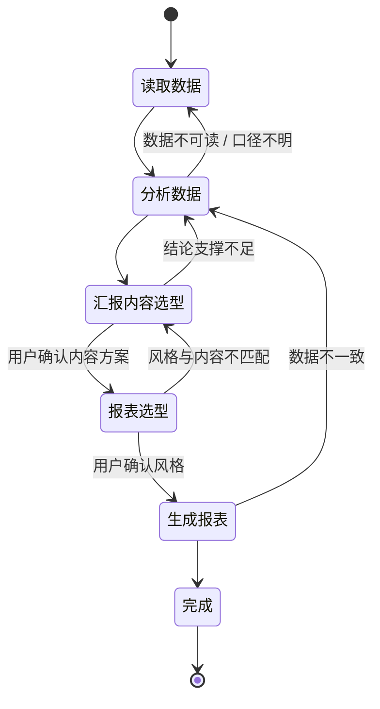

# Conspect — 数据报表引擎

数据进，报表出。上传数据源，AI 走完五个阶段，产出一份既能投屏也能打印的专业报表。

**五阶段，两个确认点。** 前两个阶段全自动；两个选型阶段各停一次问你——
因为它决定了报表「讲什么」和「长什么样」，这两件事值得你看一眼。

---

## 一、激活即执行

用户表达数据分析或报表生成意图时，按以下入口执行，**不要等额外指令**：

```
1. 确定项目路径（用户指定 > 当前工作目录）
2. read {项目路径}/.agent/harness/_cs-baton.md
3. 不存在 → 创建目录与接力棒，状态置「读取数据」
   存在   → 读 state 与 pending_confirm 字段，从断点续跑
4. 回复第一行输出：当前状态：[状态名]，下一步：[操作]
5. 按状态路由表执行当前阶段
6. 阶段完成 → 更新接力棒 → 若 pending_confirm 非空则停下等用户 → 否则自动进入下一阶段
```

**全过程纪律**：

- 不等待 `/conspect start` 才启动
- 不在两个确认点之外的地方问「下一步做什么」
- 不以「已在对话中展示」替代写入产物文件
- 不跳过质量门直接进入下一阶段
- 用户主动中断或提问时，优先响应用户，见第九节

详细分步流程见 [SKILL-execution.md](SKILL-execution.md)。

---

## 二、按需阅读指引

正文只解决「怎么走」。遇到下列情况时读对应文件——**只读与当前任务相关的那一份**：

| 遇到的情况 | 读取 |
|-----------|------|
| 要执行某一阶段的具体步骤、检查点 | [SKILL-execution.md](SKILL-execution.md) |
| **拿到一张陌生行业的表，不知道怎么判每列的角色** | [references/data-onboarding.md](references/data-onboarding.md) |
| 要调用 CLI、不确定用哪个动作、或 CLI 报错 | [references/cli-usage.md](references/cli-usage.md) |
| **观测到**具体故障（CLI/数据源/审核/权限） | [references/recovery.md](references/recovery.md) |
| 要写或校验产物、要知道有哪些产物与必需项 | [artifacts/artifact-manifest.yaml](artifacts/artifact-manifest.yaml) · [artifacts/template-artifacts.md](artifacts/template-artifacts.md) |
| 要创建/更新接力棒 | [protocols/baton-protocol.md](protocols/baton-protocol.md) |
| 要知道阶段流转、质量门、回退边 | [protocols/phase-protocol.md](protocols/phase-protocol.md) |
| **要选报表风格**（不确定选哪个、怎么挑） | `assets/catalog/catalog_l0.md`（L0）→ `assets/index/{族}.md`（L1）→ `assets/body/{编号}_{class}.md`（L2） |
| **要选报表板块**（这期该讲哪些内容） | [assets/common/block_library.md](assets/common/block_library.md) |
| 图表怎么选型 | [assets/common/chart_spec.md](assets/common/chart_spec.md) |
| 配色变量、对比度、字体栈、密度 | [assets/common/palette_guide.md](assets/common/palette_guide.md) |
| 风格资产缺失、要降级 | [assets/common/skeleton_base.md](assets/common/skeleton_base.md) |
| 某个 Agent 具体该怎么做 | `agents/` 目录下对应文件 |
| 质量审核的评分维度与判定标准 | [agents/06-quality-auditor-agent.md](agents/06-quality-auditor-agent.md) |
| 触发词、命令、程序化调用 | [references/trigger-guide.md](references/trigger-guide.md) |
| 使用示例与开场白 | [references/examples.md](references/examples.md) |
| 主控与子 Agent 如何通信 | [references/agent-communication.md](references/agent-communication.md) |
| 想知道哪些做法是错的 | [references/anti-patterns.md](references/anti-patterns.md) |
| 常见问题 | [references/faq-deep.md](references/faq-deep.md) |

---

## 三、五阶段状态机



| 阶段 | 执行者 | 核心动作 | 产物 | 质量门 | 用户确认 |
|------|--------|---------|------|--------|---------|
| **读取数据** | 读取 Agent | 枚举数据源与 Sheet、列名与类型、样本、按列质量评分、识别偏好、**探测并固化数据契约** | `_cs-datamap.md`、`_cs-schema.json` | QA-1 | 否 |
| **分析数据** | 分析 Agent | 按契约分析：维度与指标、统计、高级分析、洞察与建议 | `_cs-analysis.md`、`_cs-insights.json` | QA-2 | 否 |
| **汇报内容选型** | 内容选型 Agent | 从 22 板块中按触发条件组合出报表大纲 | `_cs-content.md` | QA-3 | **是** |
| **报表选型** | 报表选型 Agent | L0→L1→L2 三级选风格、声明资产引用、视觉自审 | `_cs-style.md` | QA-4 | **是** |
| **生成报表** | 渲染 Agent | 按板块装配 + 风格 token 渲染、多格式输出、内核验 | `_cs-dashboard.html`、`_cs-report.*`、`_cs-verify.md` | QA-5 | 否 |
| 完成 | 主控 Agent | 汇总交付说明 | `_cs-final-report.md` | — | — |

**数据契约是整条链路的地基**（详见 [references/data-onboarding.md](references/data-onboarding.md)）：

任何表进来，先判「每列是什么角色」（time / dimension / measure / identifier /
text / ignore / unknown），判定结果落成 `_cs-schema.json`，后续所有计算只读它。

| 判定来源 | 触发条件 | 可信度 | 报表口径要求 |
|---------|---------|--------|-------------|
| `contract` | 读取阶段已固化契约 | 高 | 正常声明 |
| `auto_contract` | 未固化，现场统计探测生成 | 中 | **必须声明「未经复核」并列出未确认列** |

**三级兜底**：硬证据直接判（日期可解析率、全唯一大整数、低基数枚举等）→
模糊地带标 `low`/`unknown` 交 AI 或人 → 仍判不出就保持 `unknown`，
该列不参与分析并在 B19 数据质量说明中明示。**不允许静默按关键词猜。**

实测：8 行业 59 关键列，纯统计 role 准确率 100%；`additivity`（能否求和）
统计只能判 40.9%，其余必须由契约确认——这是语义判断，不是统计问题。

**质量门不是状态**：每道门是阶段之间的检查，不通过回本阶段重做，上限 2 次；超限状态置 `FAILED`。

**两个确认点不可绕过**（详见 [protocols/phase-protocol.md](protocols/phase-protocol.md)）：

| 确认点 | 位置 | 呈现内容 | 选项 |
|--------|------|---------|------|
| 内容确认 | `_cs-content.md` 产出后 | 板块清单（编号+名称+理由）+ 被裁板块与原因 + 板块数 | ① 按此生成 ② 增删板块 ③ 重新选型 |
| 风格确认 | `_cs-style.md` 产出后 | 选型卡（族 + 编号 + 风格名 + 配色预览 + 4 条理由 + 置信度 + 2 备选） | ① 就用推荐 ② 换风格 ③ 换族重选 |

接力棒用 `pending_confirm: null|content|style` 记录等待状态；非 null 时**禁止**推进。

---

## 四、风格资产（38 风格 × 6 族）

风格资产在 `assets/`，采用三级渐进式加载——**不要一次读全部**：

| 级 | 何时读 | 读什么 | 产出 | 体量 |
|---|---|---|---|---|
| **L0 总目录** | 报表选型开始 | [assets/catalog/catalog_l0.md](assets/catalog/catalog_l0.md) | 按调性硬过滤 → 候选族 ≤3 | ≈120 行 |
| **L1 族索引** | 确定候选族后 | `assets/index/{族}.md`（≤3 个） | 锁定唯一风格 | ≈40 行/族 |
| **L2 风格正文** | 提交确认前 | `assets/body/{编号}_{class}.md`（**仅 1 份**） | 完整创作载荷 | ≈70 行 |
| 兜底 | L2 缺失时 | [assets/common/skeleton_base.md](assets/common/skeleton_base.md) | 通用骨架 + **必须明示降级** | — |

**六族**（按报表使用场景分类，不是按 UI 风格分类）：

| 族 | 调性 | 定位场景 | 风格数 |
|---|---|---|---|
| 商务通稿 `biz` | 浅色 | 正式汇报 · 年度报告 · 经营分析 · 打印分发 | 7 |
| 数据大屏 `screen` | 深色 | 会议室投屏 · 监控大屏 · 沉浸演示 · 展会轮播 | 7 |
| 玻璃光影 `glass` | 混合 | 产品发布 · 品牌质感 · 高端提案 | 6 |
| 纸感编辑 `editorial` | 浅色 | 深度研究 · 行业洞察 · 阅读型长报告 | 6 |
| 自然柔和 `organic` | 浅色 | 健康医疗 · 教育科研 · ESG · 亲和型汇报 | 6 |
| 表达张力 `bold` | 混合 | 创意提案 · 品牌宣言 · 年轻化团队 · 营销复盘 | 6 |

**资产引用门控（硬要求）**：进入生成报表阶段前，`_cs-style.md` 必须包含一行
`[资产引用] {编号}→{风格名}`，且该编号存在于 `assets/style-system.json`。
没有这一行的渲染一律视为违规——因为无法证明真的读了资产。

**不得凭记忆配色**：风格 token 只有 `style-system.json` 一个来源。
若所需风格不在资产内，走 `skeleton_base.md` 降级并明示，不得自造配色冒充某个风格。

---

## 五、报表板块库（22 板块 × 6 族）

报表由「板块」组成。板块库在 [assets/common/block_library.md](assets/common/block_library.md)，
每个板块带触发条件，**满足即纳入，不满足不纳入**——不许为了「看着丰富」硬塞。

| 族 | 板块 | 必需度 |
|---|---|---|
| 开场 OPEN | B01 封面页 · B02 执行摘要 · B03 目录导航 | 必需 · 必需 · 条件 |
| 指标 METRIC | B04 KPI 指标墙 · B05 目标达成仪表 · B06 迷你趋势卡 | 必需 · 条件 · 可选 |
| 分析 ANALYSIS | B07 趋势分析 · B08 结构构成 · B09 对比排名 · B10 归因分析 · B11 分布与离群 · B12 关联与相关 · B13 明细透视表 · B14 预测展望 | 条件（8 个） |
| 结论 CONCLUSION | B15 核心发现 · B16 风险与机会 · B17 行动建议 | 必需 · 必需 · 条件 |
| 说明 META | B18 口径与指标定义 · B19 数据质量说明 · B20 分析方法论 | 必需 · 条件 · 条件 |
| 收尾 CLOSE | B21 附录与术语 · B22 结尾与下一步 | 可选 · 必需 |

**7 个必需板块**（无条件出现）：B01 · B02 · B04 · B15 · B16 · B18 · B22。

**板块数上限**：投屏 ≤10，阅读类长报告 ≤18。超出时核心板块保底、分析族至少留 2 个，其余按族序裁剪。

---

## 六、CLI 速查

所有数据操作**必须**通过 CLI 工具层执行，不要自行写分析代码。

```powershell
cd {CLI_DIR}
'{"file_paths": ["e:/data/sales.xlsx"]}' | python run.py read_datamap
```

| 动作 | 用途 | 阶段 |
|------|------|------|
| `read_datamap` | 数据源清单（文件/Sheet/列/类型/样本/质量分） | 读取数据 |
| `read_all` | 原始结构信息（列名/类型/前 3 行样本） | 读取数据 |
| `probe_schema` | **探测每列画像，产出待终判清单（不写盘）** | 读取数据 |
| `save_schema` | **固化数据契约 `_cs-schema.json`** | 读取数据 |
| `check_schema` | 校验旧契约与新版数据是否匹配 | 读取数据 |
| `recognize_preferences` | 从需求文本识别风格与输出偏好 | 读取数据 |
| `quality_assess` | 按列数据质量评分 | 读取数据 |
| `analyze` | 全链路分析（加载→清洗→**按契约判角色**→聚合→统计→图表候选+数据议题） | 分析数据 |
| `cross_tabulate` | 任意两维度交叉聚合 | 分析数据 |
| `extract_features` | 提取数据特征 | 分析数据 |
| `calc_statistics` | 计算统计数据 | 分析数据 |
| `ai_generate_insights` | 生成洞察与建议 | 分析数据 |
| `select_content` | **按板块库产出板块组合方案** | 汇报内容选型 |
| `list_blocks` | 列出 22 板块与触发条件 | 汇报内容选型 |
| `ai_decide_chart` | 图表选型决策 | 汇报内容选型 |
| `list_styles` | 列出 6 族 38 风格 | 报表选型 |
| `select_style` | **产出风格选型建议卡**（含色系/形状/场景的人话描述） | 报表选型 |
| `render_style_preview` | **生成候选风格可视对比页**（HTML，给客户看观感） | 报表选型 |
| `build_dashboard_layout` | 按板块组装布局 | 生成报表 |
| `render_dashboard` | 渲染看板 HTML | 生成报表 |
| `render_report` | 渲染报告内容（返回内容，不写盘） | 生成报表 |
| `save_report` | 保存产物（长文本用 `content_file`） | 生成报表 |
| `save_with_chinese_name` | 保存并生成中文命名副本 | 生成报表 |
| `save_index` | 保存关联索引 | 生成报表 |

**完整动作清单**（含旧版兼容动作）、三种传参方式、`content_file` 用法：
见 [references/cli-usage.md](references/cli-usage.md)。

**调用失败时**：查 [references/recovery.md](references/recovery.md) 的决策表。
不要改用内联 Python（`python -c`）绕过——Windows PowerShell 不支持其引号嵌套，
且内联代码跳过了工具层的异常降级与路径校验。

---

## 七、数据源支持范围

| 格式 | 支持 | 说明 |
|------|------|------|
| `.xlsx` | 是 | 标准格式，推荐 |
| `.xlsm` | 是 | 含宏的 xlsx，按普通表格读取 |
| `.csv` | 是 | 自动探测 UTF-8 / GBK 编码 |
| `.xls` | **否** | openpyxl 无法读取 BIFF 格式，请另存为 `.xlsx` |
| `.json` | **否** | 不在支持范围 |

传入不支持的格式时返回带指引的可读错误，不会抛出底层的 `BadZipFile`。

---

## 八、产物

所有产物写入 `{项目路径}/.agent/harness/`，统一 `_cs-` 前缀
（与 ReqPlan-v3 的 `_baton.md` 等在同一目录下共存而不冲突）。

| 阶段 | 产物 |
|------|------|
| 读取数据 | `_cs-baton.md`、`_cs-datamap.md`、`_cs-qa-read.md` |
| 分析数据 | `_cs-analysis.md`、`_cs-insights.json`、`_cs-qa-analyze.md` |
| 汇报内容选型 | `_cs-content.md`（**待确认**）、`_cs-qa-content.md` |
| 报表选型 | `_cs-style.md`（**待确认**）、`_cs-qa-style.md` |
| 生成报表 | `_cs-render.md`、`_cs-dashboard.html`、`_cs-report.md/.html/.pdf/.docx`、`_cs-index.json`、`_cs-verify.md`、`_cs-qa-render.md` |
| 完成 | `_cs-final-report.md` |

**权威清单**（含 `required` / `confirm` 标记、模板位置、中文副本映射）：
见 [artifacts/artifact-manifest.yaml](artifacts/artifact-manifest.yaml)。

注意：`_cs-report.md`（分析报告）与 `_cs-final-report.md`（最终汇总）是两个不同产物，**不得互相覆盖**。

**产物缺失即阻断**：每个阶段结束后检查该阶段产物是否齐全，缺失则补齐后再推进。

---

## 九、用户中断处理（全阶段适用）

用户在流程执行中提出新需求、问题或调整时，暂停当前阶段并给出三个选项：

| 选项 | 行为 |
|------|------|
| 立即重置 | 接力棒状态改回「读取数据」（保留已有产物），记录中断原因与新需求 |
| 记入 TODO | 在接力棒「待办清单」章节记录，继续当前流程；当前流程完成后自动触发新任务 |
| 仅讨论 | 回答或讨论后继续当前阶段，不修改任务范围 |

随后在接力棒中记录中断时间、原因与用户选择。
本机制**优先于**自动推进——用户主动介入时不再继续自动流转。

---

## 十、数据安全

以下四条是硬约束，不因任何理由放宽：

| 原则 | 要求 |
|------|------|
| 数据不出本地 | 所有解析、分析、渲染均在本地完成，不向任何第三方服务发送用户数据 |
| 原始明细不上前端 | 生成的 HTML/JS 中含聚合后的汇总数据，明细只出 TopN |
| 只读不写 | 不修改用户上传的原始数据文件，所有结果写入独立的产物文件 |
| 日志不落地 | 不把用户数据写入对话上下文之外的外部日志 |

此外：

- 不在对话上下文中完整展示原始数据表（仅摘要与前 5 行预览）
- 不诱导用户提供敏感凭证（密码、Token、私钥）
- 检测到敏感字段时自动脱敏：

| 敏感类型 | 脱敏格式 | 示例 |
|---------|---------|------|
| 手机号 | 保留前 3 后 4 | `138****1234` |
| 身份证号 | 保留前 6 后 4 | `110101****1234` |
| 银行卡号 | 保留前 6 后 4 | `622202****1234` |
| 邮箱 | 隐藏账号名 | `a***@company.com` |
| 详细地址 | 保留到区级 | `北京市朝阳区****` |

**产物中不使用 emoji 或表情符号**（含 HTML、Markdown、图表标签）。
本条适用于**生成的产物文件**。数据解读区的级别标签使用 CSS 色块或纯文字表达。

---

## 十一、能力边界

| 类别 | 内容 |
|------|------|
| 擅长 | 多源数据合并分析、自动维度与指标分析、一键报表生成、38 风格资产选型、22 板块内容组织、质量审核、智能图表选型 |
| 需配合 | 多源关联（需声明关联键）、同比环比（需同期数据）、品牌色（需提供色值）、PDF/Word 导出（需安装可选依赖）、大数据量（需预聚合） |
| 超出范围 | 桌面 BI 集成、原始数据在线编辑、实时数据/API 接入、纯文本报告、跨表写入数据库 |

详细说明与替代方案见 [references/trigger-guide.md](references/trigger-guide.md)。

---

## 十二、子 Agent

共 7 个 Agent 协作，与 5 个阶段一一对应：

| # | Agent | 职责阶段 |
|---|-------|---------|
| 00 | 主控 Agent | 全部（调度与状态机控制） |
| 01 | 读取 Agent | 读取数据（数据清单、质量评估、偏好识别） |
| 02 | 分析 Agent | 分析数据（维度指标、统计、高级分析、洞察） |
| 03 | 内容选型 Agent | 汇报内容选型（板块组合 + 内容确认） |
| 04 | 报表选型 Agent | 报表选型（三级选风格 + 风格确认 + 视觉自审） |
| 05 | 渲染 Agent | 生成报表（装配、渲染、多格式、内核验） |
| 06 | 质量审核 Agent | 全部（独立审核，5 道门） |

协作方式与输入输出格式见 [references/agent-communication.md](references/agent-communication.md)。

---

## 十三、快速开始

上传数据文件，说清你要什么报表。

```
"帮我分析这份业务数据，出一份周报看板"
→ 读取数据 → 分析数据 → 内容选型（你确认板块）→ 报表选型（你确认风格）→ 生成

"对比一下这两个月的经营数据，做一份投屏用的报表"
→ 上传 current.xlsx 与 previous.xlsx，自动做同比分析，投屏形态限 10 个板块

"把这三个部门的业绩数据合在一起做个排名看板，风格要深色科技感"
→ 上传三份数据源，自动合并、排名；风格关键词「深色」「科技」会直接命中数据大屏族
```

建议先上传文件，再描述需求。AI 会自动识别数据结构和字段含义。
也可以输入 `/conspect start` 手动启动。

更多示例见 [references/examples.md](references/examples.md)。

---

## 十四、FAQ

**Q：为什么要停两次问我？**
因为它决定了报表「讲什么」和「长什么样」。数据和分析是全自动的，但板块组合（删掉哪个、加哪个）
与风格（投影还是大屏、克制还是张扬）属于你的判断，不该由 AI 替你拍板。

**Q：流程能中断吗？中断后怎么恢复？**
可以。中断时给出三个选项（立即重置 / 记入 TODO / 仅讨论）；
关闭对话重新打开后，接力棒机制会恢复现场，从断点续跑，`pending_confirm` 也会一并恢复。

**Q：38 种风格是不是太多了，怎么选？**
不用全看。选型阶段先读 L0 总目录（约 120 行）按调性硬过滤到 ≤3 个族，
再读族索引锁定唯一风格，最后只读 1 份正文。你只会看到一张选型卡和 2 个备选。

**Q：报表板块和风格是什么关系？**
板块决定「讲什么」（内容结构），风格决定「长什么样」（配色字体版式）。
先定板块再定风格——内容决定需要哪些图表，风格只是外衣。

**Q：可以自定义配色和品牌风格吗？**
可以。在初始需求中说明品牌色（如 `#1890FF`）与字体，会覆盖所选风格的主色。
不指定则使用默认风格 `A12 扁平无影`（浅色高密度，投影打印都安全）。

**Q：数据会上传到第三方吗？**
不会。解析、分析、渲染全部在本地完成，产物只保存在 `{项目路径}/.agent/harness/`。

**Q：产物会和 ReqPlan-v3 的 `_baton.md` 冲突吗？**
不会。本 Skill 用 `_cs-` 前缀，命名不重叠，可共存于同一 harness 目录。

**Q：支持哪些图表类型？**
覆盖 ECharts 主流类型：比较类（柱状/条形/折线/雷达）、构成类（饼图/环形/堆叠/瀑布）、
分布类（散点/热力图/箱线）、时序类（折线/面积/预测）、关系类（桑基/树图）、
仪表类（仪表盘/进度/指标卡）。规则见 [assets/common/chart_spec.md](assets/common/chart_spec.md)。

更多问题见 [references/faq-deep.md](references/faq-deep.md)。

---

## 版本信息

**版本**：4.0
**核心设计**：

- **5 阶段状态机**（读取数据 → 分析数据 → 汇报内容选型 → 报表选型 → 生成报表），
  把旧「设计」阶段按**内容决策 / 视觉决策**拆开
- **2 个用户确认点**：内容方案与风格选型各停一次；其余全自动
- **5 道质量门**，门是回路不是状态；验证由阶段降为生成报表阶段的内核验
- **38 风格 × 6 族**的三级资产（L0 目录 → L1 族索引 → L2 正文），生成物由
  `assets/style-system.json` 单一事实源产出，不手写、不漂移
- **22 板块 × 6 族**的报表内容库，按触发条件自动纳入，投屏 ≤10 / 阅读 ≤18
- **资产引用门控**：生成前必须声明 `[资产引用] 编号→风格名`
- 新增 `prose` 板块类型，承载 11 个非图表板块（封面/摘要/目录/风险机会/口径/质量/方法论/附录/结尾）
- 中文状态名 + `_cs-` 产物前缀，可与 ReqPlan-v3 共存
- 接力棒持久化，支持跨 Session 续跑（含 `pending_confirm`）
- 验证链规则 + 证据分级（已确认 / 推断 / 未核实 / 未知）

变更详情与 9→5 阶段映射见 [CHANGELOG.md](CHANGELOG.md)。
